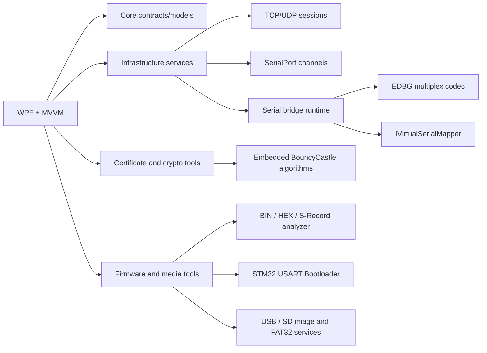

# Architecture

## 会话生命周期

`ITransportSession.StartAsync` 创建监听器或连接任务并立即返回，接收循环在后台异步运行。每个状态和数据事件都通过 `TransportMessage` 发布到 UI。`StopAsync` 取消生命周期令牌、关闭 socket、等待后台任务并释放资源。

串口通道将 `SerialPort.DataReceived` 转换成 `ReadOnlyMemory<byte>` 事件。桥接运行时为每个串口分配 `ushort` 通道号，并把数据封装成 EDBG 帧；收到远端帧后根据通道号路由回目标串口。

## 可替换点

- `ITransportService`：可替换为 TLS、WebSocket 或测试用内存传输。
- `IHttpDiagnosticsParser`：可替换为支持分块传输、WebSocket 握手和更严格 RFC 校验的解析器。
- `ISerialPortService`：可替换为厂商 SDK 或虚拟串口实现；Windows 实现同时通过可选的 `ISerialPortChangeNotifier` 发布设备插拔事件，界面合并事件后自动重新扫描串口。
- `IVirtualSerialMapper`：接入 com0com、USB 虚拟串口、远程串口驱动等。
- 固件工具将镜像解析和设备协议分开：`FirmwareImageAnalyzer` / `FirmwareImageLoader` 负责记录校验、地址段和 SHA-256；`Stm32BootloaderClient` 只依赖 `ISerialPortChannel`，可以在真实串口、网络串口和内存测试通道上复用。STM32 窗口的 DTR/RTS 序列通过可选的 `ISerialPortControl` 应用；使用同一 COM 的串口调试标签会在连接前确认并释放。`Stm32ProbeFlashService` 只处理 ST-LINK / DAPLink 暴露的 USB 大容量存储拖拽接口，SWD 擦写、校验和复位仍由探针固件负责。C51、CH347T 适配器必须按具体芯片型号提供协议实现，不能把不同 ISP / SPI NAND 时序混用。
- `CertificateCryptoService` 在基础设施层统一处理 X.509 证书、CSR、PEM/DER、标准 PKCS#12、RSA/ECDSA 和基于 BouncyCastle 的 SM2/SM3/SM4。窗口显式展示私钥和保存操作，不把密钥写入日志；标准 CA 签发使用 Windows `CertificateRequest`，SM2 证书可生成和解析，但不宣称 `SslStream` 支持完整国密 TLS 套件。
