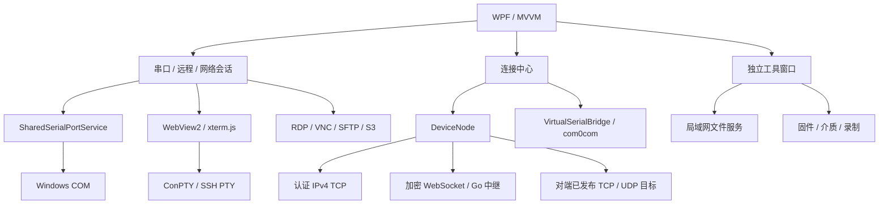

# 架构与代码导航

EmbedDesk 是 .NET 8 / WPF / MVVM 桌面应用。连接中心管理设备身份和共享服务；串口、网络、PID、摄像头共用「调试助手」的一排会话标签，远程调试保持独立工作区。二进制编辑器保留在嵌入式工具。统一标签、内部新建弹窗、连接设置与生命周期见[调试助手合并设计](DebugAssistantDesign.md)。功能、命令和发布方式见[使用指南](guide/index.md)。

## 分层与代码位置

| 项目 / 目录 | 职责 |
| --- | --- |
| `src/EmbedDesk.Core` | 模型、传输、串口、远程和诊断接口 |
| `src/EmbedDesk.Protocols` | EDBG 有界编解码、ECDH / AES-GCM 安全通道原语和旧 STCP 定义 |
| `src/EmbedDesk.Infrastructure` | 物理 / 共享串口、设备连接、网络、远程、固件、录制和安全实现 |
| `src/EmbedDesk.App` | WPF 窗口、MVVM、配置凭据、本地 ConPTY、RDP ActiveX、终端资源和托盘 |
| `EmbedDesk.Relay`（独立仓库） | Go / Gin / GORM 中继，支持 MySQL / SQLite 与 Redis；React 控制台嵌入二进制，HTTP 由反向代理提供 TLS |
| `tests` | 核心测试和独立构建的桌面 / 协议 / 文件流 Smoke 程序 |

依赖注册见 [ServiceCollectionExtensions.cs](../src/EmbedDesk.Infrastructure/ServiceCollectionExtensions.cs)，全局会话协调见 [MainWindowViewModel.cs](../src/EmbedDesk.App/ViewModels/MainWindowViewModel.cs)。

## 会话、串口与终端

各调试标签独立持有会话和后台任务，切换标签不停止收发；关闭使用标签内的 `×` 并确认。串口和网络会话各自保留配置、历史与累计 RX / TX，接收区批量格式化，隐藏页面减少界面工作但继续通信。历史自动限制为 1,000 条 / 4 MiB，文本显示约 100 万字符；原始录制在裁剪前捕获数据，详见 [性能说明](performance.md)。

`DebugAssistantWorkspace` 持有 `DebugSessionTab` 集合与常驻视图，默认无标签，不提供连接预设栏；切换只改变可见性，保留串口 Shell 的 WebView 实例。PID / 摄像头使用嵌入视图与独立协议连接，网络视图固定绑定单个会话。`DebugSessionDialog` 在主界面内提供分类新建与连接编辑，覆盖串口、TCP / UDP、PID、摄像头及 MQTT 参数；原始网络按客户端 / 服务端选择入口，在表单内选择 TCP 或 UDP。HTTP 新建入口暂缓，待调试器设计确定后再规划。串口与网络的 `BoundedDispatcherQueue` 每标签最多保留 1,024 项 / 4 MiB 待处理数据，每批最多 64 项 / 256 KiB；超载明确停止当前连接，重配后丢弃旧连接的排队回调。

`SharedSerialPortService` 统一物理 COM 的软件共享预留和独占打开：预留期间不打开设备，也不改变 DTR / RTS；远端真正请求时才提交参数并打开，关闭实际通道后保留预留。串口调试和烧录共用该资源管理器，远端应用内串口不需要系统虚拟 COM。

本地 ConPTY、SSH PTY 和串口 Shell 共用 WebView2 / xterm.js，处理 TUI、复制粘贴、字号、全屏和实际 PTY 行列。SSH 文件面板默认折叠，只有“文件”区域可拖出为窗口再合并；小文件缓存预览默认上限 5 MiB。RDP 使用系统 MSTSC ActiveX，VNC 在基础设施层解码；S3 使用 AWS SDK 与 SigV4，当前不承诺匿名桶、ACL、预签名或真实服务验收。

## 设备连接与共享

`DeviceNode` 为设备控制和中继业务维护一个认证 WebSocket。连接优先尝试认证 IPv4 TCP 直连，失败回退同一 WebSocket；授权、重连、COM、TCP / UDP 映射使用独立且有界的服务队列。UDP 按报文分帧并限制待发队列，不把中继当作额外 UDP 监听。

映射方向固定为连接方本机回环端口到被连接方已发布的 TCP / UDP 目标，不是 VPN。重连只恢复上线，不自动恢复授权、实际 COM 或监听规则。共享服务与映射界面复用连接中心；设备身份、密码学、心跳和限流边界见 [DeviceConnections.md](DeviceConnections.md)。

`VirtualSerialBridge` 对接已安装的 com0com 串口对，同步外部打开状态、格式和控制线，不自动安装驱动；实验性限制见 [VirtualSerialPorts.md](VirtualSerialPorts.md)。局域网文件服务独立维护 TCP HTTP 和 UDP 发现、断点续传与校验，不依赖中继或系统目录映射，详见 [LanFiles.md](LanFiles.md)。

`EmbedDesk.Relay` 是独立的 Go 服务仓库，`www/` 使用 React 和 Ant Design，生产构建将前端与许可嵌入 Linux 单二进制。GORM 保存用户、设备归属、节点设置和审计；推荐 MySQL，保留 SQLite。Redis 可保存控制台会话、验证码摘要和尝试限流；未配置时使用数据库。Redis 不负责跨实例路由或分布式带宽，当前服务为单实例。

控制台有管理员、注册用户和只读访客。注册使用一次性、3 分钟有效的图片验证码。节点公共 Token 只是扫描过滤值，更新仅影响后续设备注册；节点设置首次由启动配置初始化，随后数据库为准。设备先匿名接入，用户可凭 ID 领取无主设备，管理员可调整归属；凭 ID 领取不证明真实设备持有。绑定后账号内所有设备共用双向总带宽预算，同账号互传计入两端 RX/TX；匿名设备每台使用默认值。绑定、转移或修改单用户配额会断开关联设备以应用新配额。部署和接口见 [EmbedDesk.Relay README](https://github.com/Daofengql/EmbedDesk.Relay)。

管理员概览通过 `/api/console/overview` 的管理员专属 `server` 字段读取 CPU、系统内存、平均负载及中继流量采样，前端约每 2 秒刷新；普通角色不返回主机指标。RX 统计中继接收的数据 body，TX 统计成功发出的数据 body，合计和累计值不包含网卡其他流量或 WebSocket / TLS 头。未知操作系统指标保留 `null`，界面显示暂不可用；累计值只覆盖当前进程生命周期，不保存历史时序。

## 配置与生命周期

`%LOCALAPPDATA%\EmbedDesk` 保存 app-settings schema 3、窗口与工具偏好、命名预设、中继列表、共享服务和映射规则；短时间内的写入合并后以临时文件替换。schema 1 / 2 自动迁移旧导航索引和普通 TCP / UDP 预设，保留原预设记录。`remote-profiles.json` 只保存非敏感远程资料，`ssh-keys.json` 保存路径索引。设备随机凭据、静态密码、按中继条目和地址绑定的准入 Token、代理口令和可选 S3 密钥进入 Windows Credential Manager；普通设置只记录准入迁移标记，不保存 Token、会话密码、私钥内容、发送载荷、历史或业务流量。旧全局准入凭据仅供已有节点迁移使用；设置编辑区暂存 Token，保存时才提交，取消不写入凭据管理器。

配置包是独立的 `EmbedDesk.Configuration` schema 2，兼容导入 schema 1。最大 1 MiB、每类最多 100 项，产品界面导出命名远程连接和旧桥接 / STCP 预设，不导出密码、私钥路径、密钥口令、凭据索引、活动会话或新共享服务 / 映射。调试助手已移除连接预设功能，历史记录仅保留文件读取兼容，产品入口不再导入 / 导出这两类旧预设。加载配置不会恢复设备授权、实际 COM 或活动会话。

连接选项保存后下次上线生效，取消不保存。收起到托盘保留窗口、节点、共享预留和后台任务；真正退出才确认未保存内容和连接，停止服务并等待读写清理。保存与退出入口见 [AppSettingsStore.cs](../src/EmbedDesk.App/AppSettingsStore.cs) 与 [MainWindow.xaml.cs](../src/EmbedDesk.App/MainWindow.xaml.cs)。

## 工具与兼容边界

网络、固件、介质、录制和数据调试工具均通过接口或夹具替换，接口存在不表示已支持完整厂商协议。摄像头、PID 和二进制工具的边界见 [数据与调试辅助](DebugTools.md)。DNS / DoH、TLS、iperf3、固件型号和录制上限见首页及 [iperf3 协议说明](third-party/iperf3-protocol.md)。CH347T 芯片表见 [ch347-spi-support.md](ch347-spi-support.md)，证书与算法见 [security-crypto.md](security-crypto.md)。

旧 EDBG / FRP 和 `IVirtualSerialMapper` 保留用于兼容回归，没有正常产品入口；安全通道原语仍被新设备连接使用。[SerialBridgeProtocol.md](SerialBridgeProtocol.md)只描述旧 EDBG 帧格式。模拟协议、回环网络和截图检查不能替代真实中继部署、第三方客户端、开发板、Flash、物理磁盘或远程桌面验收。

Smoke 项目不在解决方案内，需单独构建；常用命令和发布 / 单文件检查见首页[开发与验证](development/index.md)与[发布](development/releasing.md)。
