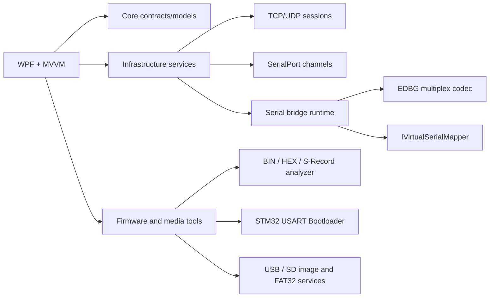

# Architecture

## 会话生命周期

`ITransportSession.StartAsync` 创建监听器或连接任务并立即返回，接收循环在后台异步运行。每个状态和数据事件都通过 `TransportMessage` 发布到 UI。`StopAsync` 取消生命周期令牌、关闭 socket、等待后台任务并释放资源。

串口通道将 `SerialPort.DataReceived` 转换成 `ReadOnlyMemory<byte>` 事件。桥接运行时为每个串口分配 `ushort` 通道号，并把数据封装成 EDBG 帧；收到远端帧后根据通道号路由回目标串口。

## 可替换点

- `ITransportService`：可替换为 TLS、WebSocket 或测试用内存传输。
- `IHttpDiagnosticsParser`：可替换为支持分块传输、WebSocket 握手和更严格 RFC 校验的解析器。
- `ISerialPortService`：可替换为厂商 SDK 或虚拟串口实现。
- `IVirtualSerialMapper`：接入 com0com、USB 虚拟串口、远程串口驱动等。
- 固件工具将镜像解析和设备协议分开：`FirmwareImageAnalyzer` / `FirmwareImageLoader` 负责记录校验、地址段和 SHA-256；`Stm32BootloaderClient` 只依赖 `ISerialPortChannel`，可以在真实串口、网络串口和内存测试通道上复用。C51、CH347T 适配器必须按具体芯片型号提供协议实现，不能把不同 ISP / SPI NAND 时序混用。
