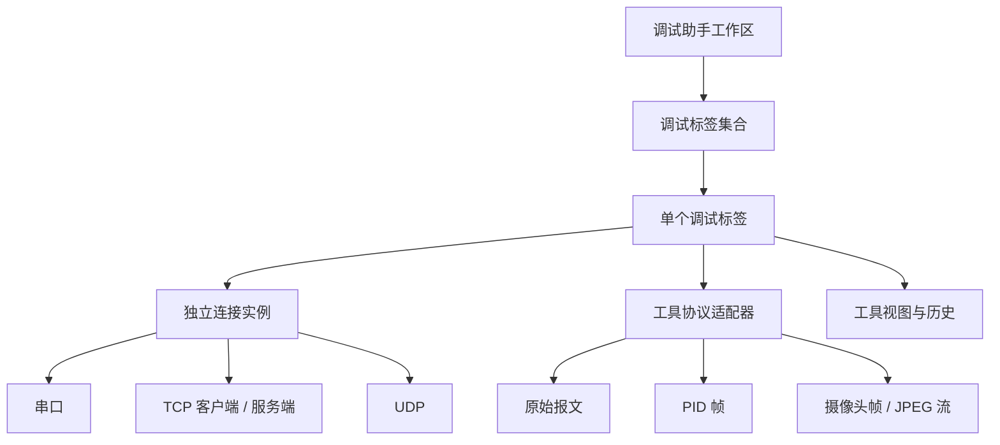

# 调试助手合并设计

本文记录串口调试、网络调试、PID 调试和摄像头调试合并为「调试助手」的产品与架构设计，以及当前工作区实现和验证边界。

## 目标

调试助手面向所有需要持续收发数据、观察设备状态或下发调试命令的工作。用户进入一个工作区后，可以像远程助手一样通过标签页创建多个独立会话：一个标签页连接串口，另一个标签页作为 TCP 服务端，第三个标签页运行 PID 曲线，第四个标签页接收摄像头图像。

合并的是工作区、标签页和连接设置体验，不是把所有数据解析器或连接强行合并。每个标签页拥有自己的连接、协议适配器、接收缓冲区、发送任务、显示历史和关闭状态。切换标签页只切换显示，不停止后台收发。

## 功能边界

调试助手包含以下实时调试标签：

| 标签类型 | 连接方式 | 主要内容 |
| --- | --- | --- |
| 串口调试 | 串口 | 文本 / HEX 收发、Shell、循环发送、队列发送、录制 |
| TCP/UDP 客户端 | TCP / UDP | 选择协议，面向指定对端收发原始报文 |
| TCP/UDP 服务端 | TCP / UDP | 选择协议，监听本机端口、管理对端和收发原始报文 |
| PID 调试 | 串口 / TCP / UDP | 参数下发、目标值、运行状态、五通道曲线、滤波和 CSV |
| 摄像头调试 | 串口 / TCP / UDP | 图像接收、JPEG 连续流、图像格式、双设备预览和寄存器读写 |
| MQTT 客户端 | MQTT / TLS | 主题发布与订阅 |

HTTP 客户端和服务端的新建入口暂时移除，待 HTTP 调试器的独立设计确定后再规划。

二进制编辑器不属于调试助手。它没有实时连接和设备协议，按当前产品安排继续保留在「嵌入式工具」的原有入口位置。烧录、存储介质和硬件编程器也继续放在「嵌入式工具」。合并串口与网络调试后，原有两个主入口收敛为一个「调试助手」主入口；二进制编辑器不新增顶层导航。

## 导航与标签

主工作区使用「调试助手」作为实时调试入口，替换原先分开的串口调试和网络调试主入口。默认没有会话标签，显示「开始第一个调试会话」。标签栏的 `+` 与空状态的新建按钮打开同一个界面内弹窗，弹窗通过遮罩覆盖当前工作区，不创建新的 Windows 窗口。先按小分类选择类型，再在同一弹窗中填写连接参数，支持返回、取消、关闭和 Esc；取消不创建标签。

**只使用一级会话标签，参考远程调试。** 串口、TCP、UDP、PID、摄像头标签直接并列在同一排；不先分成四个功能标签，再在内部嵌套会话标签或会话列表。主导航为「连接中心」「调试助手」「远程调试」「网络工具」「嵌入式工具」。串口的收发 / Shell 是当前会话的显示模式切换，不是另一层会话标签。

```text
新建调试会话
├─ 基础通信：串口调试、TCP/UDP 客户端、TCP/UDP 服务端
├─ 设备调试：PID 调试、摄像头调试
└─ 应用协议：MQTT 客户端
```

标签标题包含类型和用户可编辑的短名称，例如 `串口 · COM3`、`TCP 服务端 · 9000`、`PID · 开发板 A`。每个标签显示独立状态圆点和关闭按钮 `×`，悬停可查看状态；标签可双击改名、拖动排序。关闭标签先确认，再停止该标签的任务并等待资源释放。

空状态页显示「开始第一个调试会话」，并提供新建按钮；关闭最后一个标签后也回到该空状态，不自动补建串口标签。工作区不因为当前标签连接失败而停止其他标签，单个标签的错误只更新自己的状态和日志。

## 统一连接设置

连接设置在新建弹窗中填写；标签栏右侧的设置按钮可编辑当前已停止会话的连接参数。共用通信表单，不提供连接预设选择、保存、更新或导入 / 导出功能，也不在标签栏下额外占用一行。

串口显示设备、波特率、数据位、校验、停止位和流控；硬件流控默认关闭，选择设备和创建标签不打开串口。未接入设备时也可先创建串口、PID 或摄像头标签。原始网络入口先区分客户端和服务端，进入表单后选择 TCP 或 UDP。客户端显示远程地址、端口和本地绑定，选择 TCP 时另显示连接超时与自动重连；服务端显示本机监听地址与端口。UDP 客户端只与指定目标通信；UDP 服务端默认接收多个对端，也可勾选「锁定首个发送端」。PID 和摄像头的连接方式也统一为串口、TCP/UDP 客户端、TCP/UDP 服务端，选择网络角色后再选协议；工具 UDP 服务端自动锁定首个发送端，重新连接后解除锁定，不混合多个设备的协议流。

串口、PID 和摄像头创建标签后由会话内按钮发起连接；网络类型点击「创建并启动」后进入标签并显示连接过程。MQTT 使用同一个内部弹窗，显示主题、可选用户名 / 密码和 TLS。编辑连接前必须停止当前连接及发送任务，应用设置不会自动重新连接，也不修改其他标签。

工具字段放在会话内容区，由标签类型决定：

- 串口调试：显示模式、编码、HEX 开关、发送任务和录制选项。
- 原始 TCP / UDP：报文显示、文本 / HEX、对端筛选和发送选项。UDP 默认按数据报分行；TCP 按接收片段记录，读取边界不等于应用协议帧，不推断任意固件的分帧格式。
- PID：通道、参数、目标值、周期、曲线时间窗、移动平均或指数平滑。
- 摄像头：兼容协议或 JPEG 连续流、CRC 校验、RGB565 字节序、显示设备和寄存器宽度。

公共连接设置不能覆盖工具协议设置。比如 PID 和摄像头都可以使用 TCP，但它们的帧解析和确认方式始终由各自适配器处理。

## 普通收发标签的空间分配

串口调试和原始 TCP / UDP 调试的核心是接收区，合并后把更多垂直空间留给接收内容：

- 接收区使用剩余空间，设置较高的最小高度；窗口变窄或变矮时优先保留接收区。
- 发送区使用较小且稳定的固定高度，串口 88 px、网络 86 px；保留输入框、HEX / CRLF 选项和发送按钮，不让发送编辑器继续按内容扩张。
- 发送区的输入框保持一到两行可见，超出内容在输入框内部滚动；发送按钮使用紧凑布局，避免占用整行高度。
- 发送工具侧栏、循环发送和队列发送保持独立，不把它们的高度计算到主接收区中。
- Shell 模式不使用这套收发比例，继续让统一终端占据主要区域；切换模式时不销毁后台连接。

推荐的普通收发布局如下：

```text
┌──────────────────────────────────────────────┐
│ 标签栏 / 连接状态 / 协议设置                  │
├──────────────────────────────────────────────┤
│                                              │
│              主接收区（剩余空间）             │
│                                              │
├──────────────────────────────────────────────┤
│ 发送：输入框（约 1–2 行）  HEX CRLF  [发送]   │
└──────────────────────────────────────────────┘
```

最小窗口仍需完整显示接收区标题、最后一行接收内容、发送输入框和发送按钮；空间不足时先压缩发送区留白和工具栏间距。发送工具保持常驻侧栏，队列内部滚动，不新增“发送工具”开关。

## 分层结构



连接层提供统一的启动、停止、发送、状态、取消和错误边界。协议适配器负责有界缓冲、分帧、校验、解析和确认。视图只消费适配器产生的结构化事件，不直接读取串口或 Socket。

内部弹窗 `DebugSessionDialog` 使用 `DebugToolEndpoint` 表达通信参数，通过适配转换接入串口会话、网络 `TransportOptions` / `ITransportSession` 和 PID / 摄像头的 `DebugToolConnection`。各标签拥有自己的连接、解析器和取消令牌，不让两个解析器订阅同一个可变字节流。原 PID / 摄像头窗口仅保留为兼容包装，正常入口直接使用嵌入视图。

## 连接与资源生命周期

- 标签切换不停止连接、收发、录制或曲线累计。
- TCP 服务端标签可以维护多个对端；PID 和摄像头标签默认只绑定一个协议会话。
- UDP 标签明确是目标发送、监听或首个发送端锁定，不把不同语义隐藏在同一个“UDP”选项里。
- 串口使用统一资源管理器，打开前检查占用；关闭标签后释放本次独占。
- 接收队列有界。串口 / 网络的待处理队列上限为 1,024 项 / 4 MiB，每次调度最多处理 64 项 / 256 KiB；处理速度跟不上时停止当前连接并显示原因，不影响其他标签。工具串口为最多 32 包、每包不超过 256 KiB，TCP / UDP 工具顺序处理，PID 历史和摄像头最新帧缓存各自有界。
- 关闭标签时取消读取、发送、录制和导出任务，并等待任务退出后再释放连接。
- 标签之间不共享可变接收缓冲区、解析器、历史集合或取消令牌。

## 迁移顺序

1. 先建立调试助手工作区和标签模型，暂时复用现有串口、网络、PID、摄像头窗口的业务代码。
2. 把串口和网络的公共连接表单提取为统一的内部连接编辑器，保持当前通信行为不变。
3. 将原串口会话和网络会话迁移为调试标签，先完成切换、排序、关闭确认和后台生命周期。
4. 将 PID 和摄像头适配器接入同一标签容器，保留各自工具栏、曲线、图像和协议设置。
5. 更新主导航和空状态入口，旧窗口保留为兼容包装，移除正常产品中的重复入口。
6. 二进制编辑器继续留在「嵌入式工具」现有入口，不引入调试标签依赖。

## 验收标准

- 可以在同一个调试助手工作区同时创建串口、TCP 服务端、PID 和摄像头标签。
- 任意标签连接失败、停止或关闭，不会停止其他标签的收发。
- 标签切换后，后台累计计数、曲线、图像和接收历史保持连续。
- 相同通信参数可以创建多个标签，但每个标签的连接实例和协议解析器独立。
- PID 的滤波只影响显示和可选导出列；摄像头校验、解码和寄存器确认不被原始网络显示逻辑干扰。
- 串口占用、TCP 端口占用、UDP 对端锁定和取消操作都能显示真实状态。
- 默认尺寸和最小尺寸下，标签栏、连接设置、工具设置、状态和主要内容完整可见。
- 回环测试覆盖多标签并行生命周期、串口与 TCP / UDP 连接、PID / 摄像头协议适配器和关闭清理；真实开发板、摄像头和 PID 控制器仍需单独实测。

## 当前实现说明

当前工作区已使用 `DebugAssistantWorkspace` / `DebugSessionTab` 实现一级会话标签；串口、网络、PID、摄像头可并行运行，切换保留视图与后台连接。默认无标签，分类新建与连接编辑使用主界面内部弹窗，已移除连接预设栏。已接入独立通信参数、旧导航迁移、UDP 模式、关闭清理和有界接收。历史配置中的预设记录仅保留读取兼容，不恢复入口，也不再通过产品界面导入 / 导出。PID 保留 50 ms–600 s 时间窗及移动平均 / 指数平滑，最小窗口将实际值和设备状态固定显示在连接行右侧。二进制编辑器仍在「嵌入式工具」原入口。

回归入口为 `--serial-tabs-check`、`--desktop-network-check`、`--debug-tools-check`、`--debug-connections-check` 和 `--app-settings-check`，覆盖空状态、分类内部弹窗的创建 / 返回 / 取消、混合标签并行收发、独立实例、活动连接拒绝重配、串口互斥、UDP 锁定 / 重连、旧回调隔离、接收超载、设置持久化及默认 / 最小尺寸截图。通信验证使用本机回环和模拟串口；真实开发板、摄像头及 PID 控制器仍需实测。协议与编辑能力的具体限制见 [数据与调试辅助](DebugTools.md)。
